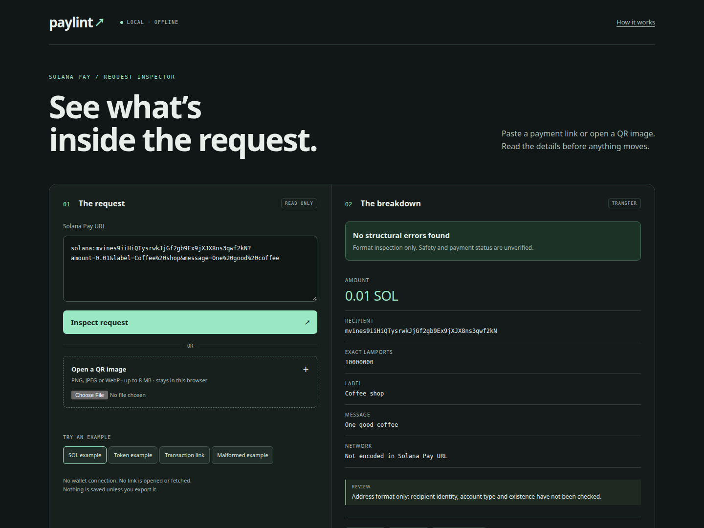

# paylint

Read the Solana Pay request behind a link or QR code.



[](https://github.com/royalpinto007/paylint/actions/workflows/ci.yml)
[MIT](LICENSE) · [Architecture](docs/architecture.md) · [What gets checked](docs/checks.md)

```sh
npx @royalpinto007/paylint
```

Open **http://127.0.0.1:4460**. Node.js 22.18+ required.

- Paste a Solana Pay link or open a local QR image.
- Inspect recipients, exact amounts, token mints, references and metadata.
- Spot invalid addresses, precision errors and duplicate parameters.
- Copy diagnostics or export JSON and Markdown.

**No wallet or payment.** Parsing and image decoding stay local. Transaction-request endpoints are displayed without fetching them. A structurally valid link is not proof of safety or payment.

### CLI

```sh
npx @royalpinto007/paylint 'solana:mvines9iiHiQTysrwkJjGf2gb9Ex9jXJX8ns3qwf2kN?amount=0.01' --json
npx @royalpinto007/paylint --port 4465
```

Quote URLs so your shell preserves `&`. QR image inspection is available in the dashboard. Exit `0`: no structural errors. Exit `1`: malformed or unsupported request. Exit `2`: usage or server error.

### From source

```sh
git clone https://github.com/royalpinto007/paylint.git
cd paylint
npm install
npm run demo
```

`npm run check`, `npm run test:e2e` and `npm run package:check` verify the parser, local server, browser flows and installed package.

No database, telemetry or saved history. Only explicit exports create files. Installing through npm uses the network; inspection does not.
