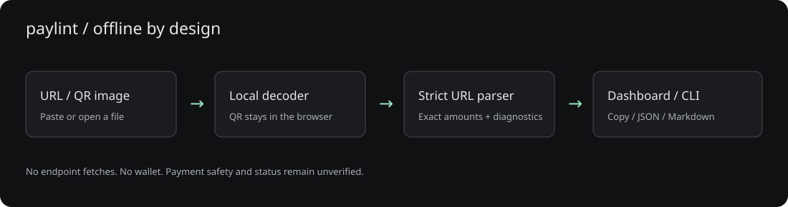
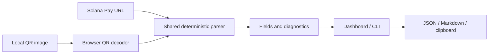

# Architecture

A small Node HTTP server serves bundled browser assets on loopback. It accepts no inspection data or uploads. The browser decodes images locally and calls the same parser as the CLI.

Amount conversion uses string parsing and BigInt, avoiding floating-point rounding. Untrusted metadata is inserted with textContent. A restrictive Content Security Policy blocks outbound connections. No link is followed, no transaction is fetched, and no wallet code is included.
